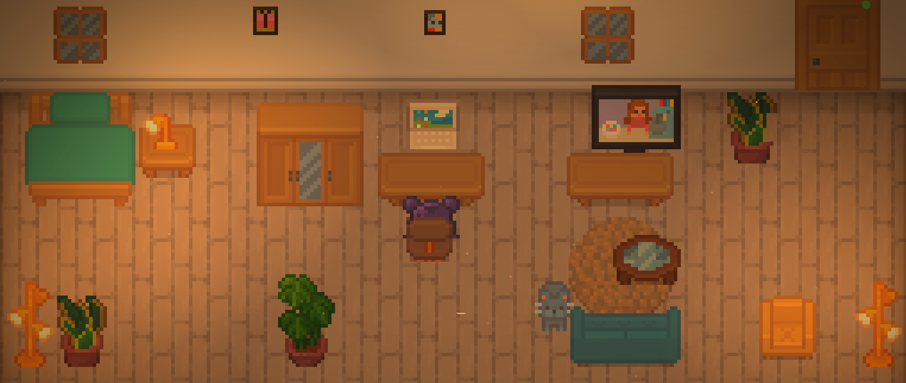

  
   
  <i>A room from <a href="https://cozy-hallway.zyrodev.in/">Cozy Hallway</a>, the game I'm building right now</i>

<h1 align="center">Nishaj (Zyro)</h1>

<b>Software Engineer</b>

  I build all kinds of things and I like knowing how they work. 
  My side projects have side projects.

### Projects

| | |
|---|---|
| [**Claude for Everything**](https://cfe.zyrodev.in/) | Free Claude skills, plugins and MCP servers, organised by the task you need done. |
| [**Little Lodgers**](https://little-lodgers.zyrodev.in/) | A cozy room-arranging logic puzzle for Android. |
| [**Cozy Hallway**](https://cozy-hallway.zyrodev.in/) | A multiplayer pixel hangout: decorate a room, play lofi music, chat and focus with friends. |
| [**Ryze**](https://ryze.zyrodev.in/) | A gym progress tracker: plan your split, log every set, know when to add weight. |
| [**Portal Bot**](https://portalbot.zyrodev.in/) | A Discord bot for making new friends and chatting with people from around the world. |

### Find me

<samp>
<a href="https://nishaj.zyrodev.in/">portfolio</a> .
<a href="https://www.linkedin.com/in/nishaj0/">linkedin</a> .
<a href="https://twitter.com/nishaj0">x</a> .
<a href="mailto:njnishaj0@gmail.com">email</a>
</samp>
